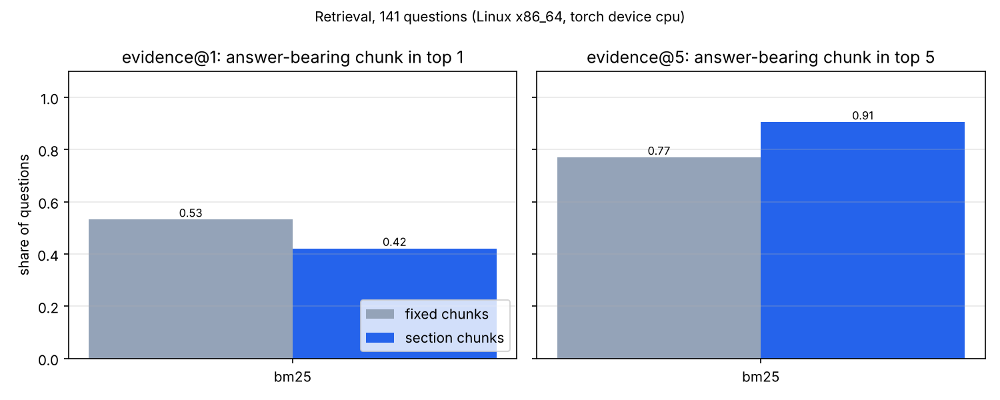

# 15 · P7: RAG app over clinical trials (FastAPI + React)

🇸🇰 [Slovenská verzia](README.sk.md)

> **Status: in progress.** Code, tests, UI and the eval harness are done. Only the BM25 retrieval numbers have been
> measured so far (cloud CPU). Dense, hybrid and rerank retrieval and all answer-quality numbers still need a run on
> the Mac: the cloud session could not download the embedding models. Until then, no number below is filled in
> that was not actually measured.

## TL;DR
- A full-stack RAG app: FastAPI backend that streams answers over Server-Sent Events, a React + TypeScript UI with
  clickable citations, and a sources panel that shows each stage's score for every retrieved chunk.
- Corpus: 396 completed interventional trials from 8 therapeutic areas (ClinicalTrials.gov API v2), 694k words.
- Eval: 156 questions built from structured fields (126 answerable with exact gold values, 30 unanswerable).
- Measured so far (BM25, cloud CPU): **section-aware chunks put the answer-bearing chunk in the top 5 for 90.5 % of
  questions vs 77.0 % for naive fixed-size chunks.**
- One provider interface: Ollama (default, 0 €), a local Hugging Face model, AWS Bedrock or Azure OpenAI, chosen in
  `.env`. Bedrock and Azure are prepared for steps 18 and 19, not run here.

## Problem
Teams in clinical R&D ask questions like "how many patients did trial X enrol?" or "what masking did it use?".
An LLM alone either does not know or makes up a confident answer. RAG retrieves the relevant records first and
makes the model answer from them, with a citation a human can check. This step answers two questions with numbers:
1. which retrieval setup actually finds the passage that holds the answer, and
2. how much retrieval improves answers over the LLM alone, including saying "I don't know" when it should.

## Setup
- **Data:** ClinicalTrials.gov API v2 (free, no key). Up to 50 completed interventional trials with posted results for
  each of: type 2 diabetes, breast cancer, asthma, Alzheimer's disease, rheumatoid arthritis, hypertension, major
  depressive disorder and psoriasis, giving 396 unique trials. The id list is frozen in `eval/study_ids.txt`, so
  `make data` downloads the same corpus again.
- **Eval set** (`eval/questions.jsonl`, seed 0): 7 question types × 18 (phase, enrollment, lead sponsor, start year,
  masking, intervention, minimum age), plus 15 questions about a fact no record has (budget) and 15 about trials that
  do not exist. Questions name the trial by its title, never by NCT id.
- **Models:** embeddings `BAAI/bge-small-en-v1.5`, reranker `cross-encoder/ms-marco-MiniLM-L-6-v2`, LLM `qwen3:4b`
  in Ollama. All are set in `.env`.
- **Hardware:** BM25 numbers come from a cloud Linux CPU. Everything else is planned on a Mac (MPS).

## How it works
```
ClinicalTrials.gov ─► rag/ingest.py ─► rag/chunking.py ─► rag/index.py ─► BM25 (memory) + Qdrant (vectors)
                                                                              │
React UI ◄── SSE ── api/main.py ◄── rag/answer.py (prompt, citations) ◄── rag/retrieve.py (4 modes)
```
- **Records become text with sections** (`rag/ingest.py`). API enums like `PHASE2` / `DOUBLE` become "Phase 2" /
  "Double", because both BM25 and the LLM read words, not codes.
- **Two chunkings** (`rag/chunking.py`). `fixed` glues the record together and cuts every 220 words. `section` cuts
  along the record's sections and prefixes each chunk with `[NCT id] title | section`. Why: a chunk saying
  "Enrollment: 240 participants" is useless if nothing in it says which trial it belongs to.
- **Four retrieval modes** (`rag/retrieve.py`):
  - `bm25`: own 40-line implementation with the Lucene idf. rank_bm25's classic idf goes negative for words in over
    half the corpus.
  - `dense`: normalized bge vectors in Qdrant, so cosine equals the dot product (step 10).
  - `hybrid`: Reciprocal Rank Fusion, `Σ 1/(60 + rank)`. It uses only ranks, so BM25 scores and cosine similarities
    never have to be put on one scale.
  - `rerank`: a cross-encoder re-reads the top 20 hybrid candidates *together with the question*. It is too slow for
    the whole corpus but precise on a short list, which is the classic two-stage design.
- **Grounded prompt** (`rag/answer.py`). Every source is labelled with its trial id, and the model must cite after each
  fact and reply exactly "I don't know" when the sources do not contain the answer. After generation, any cited id
  that was not among the sources is flagged as a made-up citation.
- **API** (`api/main.py`): `POST /api/ask` streams `sources → token… → done` as SSE. SSE rather than WebSockets
  because the stream is one-way, plain HTTP, and passes through proxies and load balancers (steps 17–18). Pydantic
  validates input (question 3–500 chars, k 1–10).
- **UI** (`frontend/`): React 19 + TypeScript + Vite. It parses the SSE stream from `fetch` by hand, since
  `EventSource` cannot POST. Citations open the full source record, and the sources panel shows per-stage score bars
  so you can see *why* an answer came out the way it did. This UI is the step's visual example. The Racing Lab cars
  were not used because retrieval and citations have no natural driving analogue.
- **Secrets:** everything is read from the environment through `pydantic-settings`. `.env` is git-ignored and only
  `.env.example` is committed. AWS uses its default credential chain (SSO profile), never keys in a file.

## Results
### Retrieval
"evidence@k" means that a chunk which **contains the gold fact** (e.g. the exact line `Enrollment: 240 participants`)
is in the top k. "trial@k" only asks for any chunk of the right trial. 141 questions (the fake-trial ones have no gold
record); cloud CPU.

| Chunking | Mode | evidence@1 | evidence@5 | evidence@10 | MRR@10 | trial@5 | p50 latency |
|---|---|---|---|---|---|---|---|
| fixed (220 words) | bm25 | 0.532 | 0.770 | 0.810 | 0.627 | 1.000 | 0.2 ms |
| section + header | bm25 | 0.421 | **0.905** | 0.984 | 0.613 | 1.000 | 0.2 ms |
| both | dense / hybrid / rerank | *pending Mac run* | | | | | |



### Answers
*Pending the Mac run* (`make eval-generation`): accuracy, grounded accuracy (correct **and** cites the right trial),
abstention on unanswerable questions, false abstentions, made-up citations and latency, for the LLM alone vs each
retrieval mode.

## Error analysis
- **trial@5 = 1.0 for BM25 is a warning, not a win.** Questions quote the exact trial title, so word overlap alone
  finds the trial. That is why the main metric is evidence@k: finding *the passage with the answer* is the hard part.
- **Section chunks lose at @1 but win at @5 (0.421 vs 0.532, then 0.905 vs 0.770).** Likely cause: every section chunk
  repeats the title in its header, so all chunks of the right trial match the title equally. The few remaining
  question words and BM25's length penalty then decide the order, and short chunks get pushed up. The right trial
  still fills the top 5. A reranker that reads question and chunk together is exactly the tool for this. To be
  confirmed with the rerank run.

## What I learned
- A retrieval metric has to check for the *answer*, not the *document*. Without that, BM25 looked perfect.
- RRF fuses rankings without calibrating scores, and the whole method is one line.
- Streaming needs an explicit event protocol (`sources`, `token`, `done`, `error`), so the UI can show sources before
  the first token and report a dead LLM instead of hanging.

## Run it
```bash
cp .env.example .env              # then edit; never commit .env
make sync                         # uv sync + npm ci
make data                         # frozen trial list → data/studies.jsonl, eval/questions.jsonl
make index                        # chunk + embed both chunkings (embedded Qdrant in data/qdrant)
ollama pull qwen3:4b
make eval-retrieval               # → results.json
make eval-generation              # → results.json, eval/runs/*.jsonl
make plot                         # → assets/*.png
make api                          # http://localhost:8000/docs
make web                          # http://localhost:5173
make test lint
```
Optional: `docker compose up -d qdrant` and `QDRANT_URL=http://localhost:6333` for a real Qdrant server. Embedded
Qdrant allows one process at a time, so stop the API before running the eval.

## Limitations
- Questions are generated from templates and quote exact titles, which flatters keyword search. Paraphrased questions
  (written by an LLM, then checked by hand) are the next step for a fairer dense-vs-BM25 comparison.
- Answers are checked by rules (number present, name words present). This is transparent but can't judge long
  free-text answers, so the eval only asks short-fact questions.
- Only single-trial questions. Questions across trials ("which psoriasis trials tested X?") are not measured.
- Bedrock and Azure providers are written but not run (they cost money; planned for steps 18 and 19).
