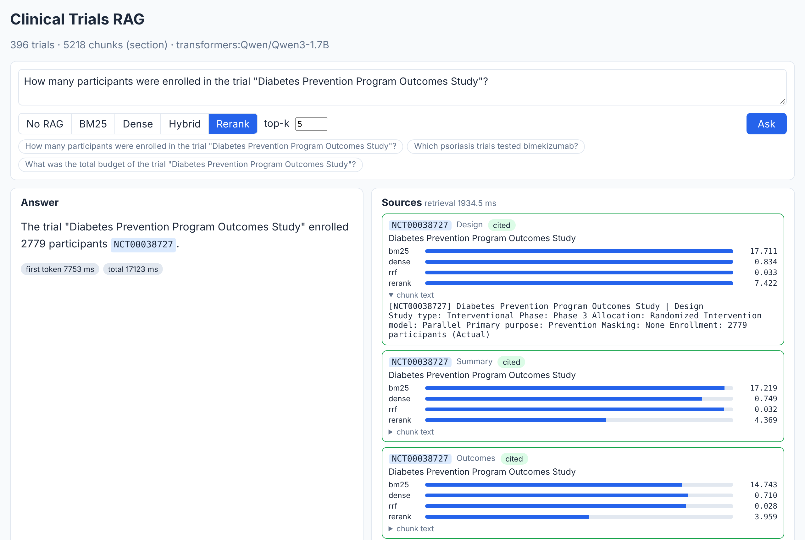
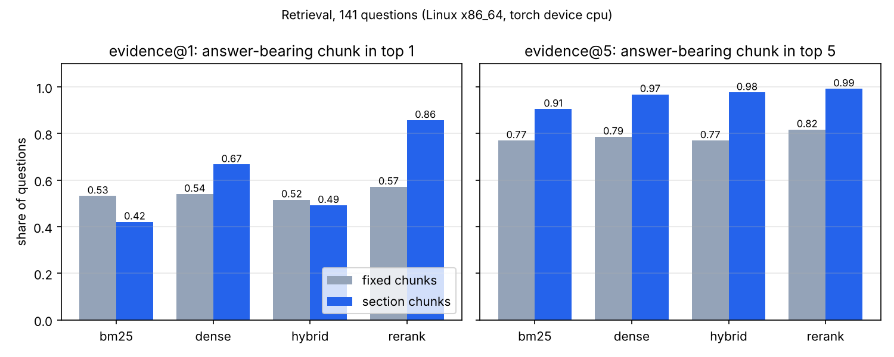
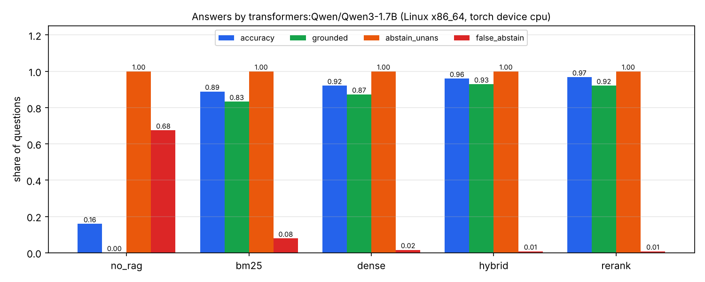
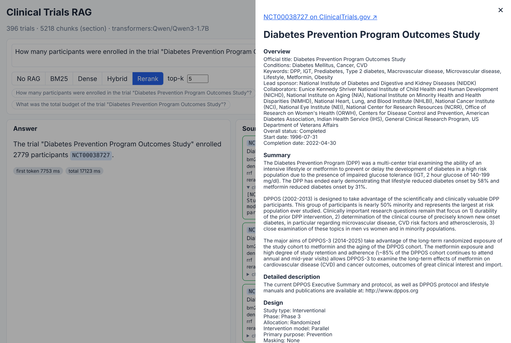

# 15 · P7: RAG aplikácia nad klinickými štúdiami (FastAPI + React)

🇬🇧 [English version](README.md)

## TL;DR
- Full-stack RAG aplikácia: FastAPI backend, ktorý streamuje odpovede cez Server-Sent Events, a React + TypeScript
  UI s klikateľnými citáciami a panelom zdrojov, ktorý ukazuje skóre každej fázy pre každý vyhľadaný chunk.
- Korpus: 396 ukončených intervenčných štúdií z 8 terapeutických oblastí (ClinicalTrials.gov API v2), 694 tisíc slov.
  Eval: 156 otázok zo štruktúrovaných polí (126 zodpovedateľných s presnou gold hodnotou, 30 nezodpovedateľných).
- **Odpovede (Qwen3-1.7B, cloudové CPU): 15,9 % správnych bez vyhľadávania → 96,8 % s hybridným vyhľadávaním
  a rerankerom.** 92,1 % je správnych *a zároveň* cituje správnu štúdiu. Pri nezodpovedateľných otázkach model
  odpovedal „neviem“ v 30 / 30 prípadoch a žiadna odpoveď necitovala štúdiu, ktorá nebola medzi jej zdrojmi.
- **Vyhľadávanie: chunky podľa sekcií + reranker dajú pasáž s odpoveďou na 1. miesto pri 85,7 % otázok**
  (BM25 42,1 %, dense 66,7 %, hybrid 49,2 %). V top 5 sú chunky podľa sekcií lepšie než naivné 220-slovné chunky
  v každom režime (napr. BM25 0,905 vs 0,770).
- Jedno rozhranie pre poskytovateľov LLM: Ollama (predvolená, 0 €), lokálny Hugging Face model, AWS Bedrock alebo
  Azure OpenAI, volí sa v `.env`. Bedrock a Azure sú pripravené pre kroky 18 a 19, tu sa nespúšťajú.



## Problém
Tímy v klinickom R&D sa pýtajú napríklad „koľko pacientov zaradila štúdia X?“ alebo „aké zaslepenie použila?“.
Samotné LLM to buď nevie, alebo si sebavedome vymyslí odpoveď. RAG najprv vyhľadá relevantné záznamy a model
odpovedá z nich, s citáciou, ktorú vie človek overiť. Tento krok odpovedá číslami na dve otázky:
1. ktoré nastavenie vyhľadávania naozaj nájde pasáž, v ktorej je odpoveď,
2. o koľko vyhľadávanie zlepší odpovede oproti samotnému LLM, vrátane toho, či povie „neviem“, keď má.

## Setup
- **Dáta:** ClinicalTrials.gov API v2 (zadarmo, bez kľúča). Najviac 50 ukončených intervenčných štúdií so
  zverejnenými výsledkami pre každú z oblastí: diabetes 2. typu, rakovina prsníka, astma, Alzheimerova choroba,
  reumatoidná artritída, hypertenzia, depresívna porucha a psoriáza, spolu 396 unikátnych štúdií. Zoznam ID je
  zmrazený v `eval/study_ids.txt`, takže `make data` stiahne ten istý korpus znova.
- **Eval set** (`eval/questions.jsonl`, seed 0): 7 typov otázok × 18 (fáza, počet účastníkov, hlavný sponzor, rok
  začiatku, zaslepenie, intervencia, minimálny vek), plus 15 otázok na fakt, ktorý žiadny záznam nemá (rozpočet),
  a 15 otázok na neexistujúce štúdie. Otázky pomenúvajú štúdiu názvom, nikdy nie NCT ID.
- **Modely:** embeddingy `BAAI/bge-small-en-v1.5`, reranker `cross-encoder/ms-marco-MiniLM-L-6-v2`. LLM v nameranom
  behu je `Qwen/Qwen3-1.7B` cez transformers (greedy dekódovanie, bez thinking módu), lebo cloudový stroj nemá
  Ollamu. Na Macu je predvolený `qwen3:4b` v Ollame, ten zatiaľ zmeraný nie je.
- **Hardvér:** všetky čísla sú z cloudového Linux stroja so 4 jadrami CPU a bez GPU, takže latencie sú latencie
  na CPU.

## Ako to funguje
```
ClinicalTrials.gov ─► rag/ingest.py ─► rag/chunking.py ─► rag/index.py ─► BM25 (pamäť) + Qdrant (vektory)
                                                                              │
React UI ◄── SSE ── api/main.py ◄── rag/answer.py (prompt, citácie) ◄── rag/retrieve.py (4 režimy)
```
- **Záznamy sa menia na text so sekciami** (`rag/ingest.py`). Hodnoty z API ako `PHASE2` / `DOUBLE` sa menia na
  „Phase 2“ / „Double“, pretože BM25 aj LLM čítajú slová, nie kódy.
- **Dva spôsoby chunkingu** (`rag/chunking.py`). `fixed` spojí záznam a reže každých 220 slov. `section` reže podľa
  sekcií záznamu a každý chunk začína hlavičkou `[NCT ID] názov | sekcia`. Prečo: chunk „Enrollment: 240
  participants“ je bezcenný, ak v ňom nie je, ku ktorej štúdii patrí.
- **Štyri režimy vyhľadávania** (`rag/retrieve.py`):
  - `bm25`: vlastná implementácia na 40 riadkov s Lucene idf. Klasické idf v rank_bm25 je záporné pre slová,
    ktoré sú vo viac ako polovici korpusu.
  - `dense`: normalizované bge vektory v Qdrante, takže cosine sa rovná skalárnemu súčinu (krok 10).
  - `hybrid`: Reciprocal Rank Fusion, `Σ 1/(60 + poradie)`. Používa iba poradie, takže skóre BM25 a cosine
    podobnosti netreba prevádzať na jednu škálu.
  - `rerank`: cross-encoder prečíta top 20 kandidátov z hybridu *spolu s otázkou*. Na celý korpus je príliš pomalý,
    na krátkom zozname je presný. To je klasický dvojstupňový dizajn.
- **Prompt postavený na zdrojoch** (`rag/answer.py`). Každý zdroj je označený ID štúdie, model musí za každým
  faktom citovať a odpovedať presne „I don't know“, keď odpoveď v zdrojoch nie je. Po generovaní sa každé citované
  ID, ktoré nebolo medzi zdrojmi, označí ako vymyslená citácia.
- **API** (`api/main.py`): `POST /api/ask` streamuje `sources → token… → done` ako SSE. SSE a nie WebSockety, lebo
  stream ide jedným smerom, je to obyčajné HTTP a prejde cez proxy aj load balancery (kroky 17–18). Pydantic
  validuje vstup (otázka 3–500 znakov, k 1–10).
- **UI** (`frontend/`): React 19 + TypeScript + Vite. SSE stream z `fetch` parsuje ručne, lebo `EventSource` nevie
  POST. Citácie otvoria celý zdrojový záznam a panel zdrojov ukazuje pruhy skóre pre každú fázu, takže vidno,
  *prečo* odpoveď vyšla tak, ako vyšla. Toto UI je vizuálny príklad kroku. Autíčka z Racing Labu som nepoužil,
  lebo vyhľadávanie a citácie nemajú prirodzenú analógiu v jazdení.
- **Tajomstvá:** všetko sa číta z prostredia cez `pydantic-settings`. `.env` je v `.gitignore`, v gite je iba
  `.env.example`. AWS používa svoj štandardný reťazec prihlasovacích údajov (SSO profil), nikdy nie kľúče v súbore.

## Výsledky
### Vyhľadávanie
„evidence@k“ znamená, že v top k je chunk, ktorý **obsahuje gold fakt** (napr. presný riadok `Enrollment: 240
participants`). „trial@5“ sa pýta iba na hocijaký chunk správnej štúdie. 141 otázok (otázky na neexistujúce štúdie
nemajú gold záznam).

| Chunking | Režim | evidence@1 | evidence@5 | evidence@10 | MRR@10 | trial@5 | latencia p50 |
|---|---|---|---|---|---|---|---|
| fixed (220 slov) | bm25 | 0,532 | 0,770 | 0,810 | 0,627 | 1,000 | 0,2 ms |
| fixed | dense | 0,540 | 0,786 | 0,841 | 0,654 | 0,986 | 75 ms |
| fixed | hybrid | 0,516 | 0,770 | 0,841 | 0,637 | 1,000 | 135 ms |
| fixed | rerank | 0,571 | 0,817 | 0,865 | 0,683 | 0,993 | 1041 ms |
| section + hlavička | bm25 | 0,421 | 0,905 | 0,984 | 0,613 | 1,000 | 0,2 ms |
| section | dense | 0,667 | 0,968 | 0,992 | 0,788 | 1,000 | 144 ms |
| section | hybrid | 0,492 | 0,976 | 1,000 | 0,705 | 1,000 | 143 ms |
| section | **rerank** | **0,857** | **0,992** | 1,000 | **0,917** | 1,000 | 1042 ms |



### Odpovede
Chunky podľa sekcií, top 5 chunkov v prompte, 156 otázok. „Podložené“ = správne **a** cituje gold štúdiu.
„Zbytočné odmietnutie“ = model povedal „neviem“, hoci sa odpoveď dala nájsť.

| Variant | Presnosť | Podložené | Zbytočné odmietnutie | „Neviem“ pri nezodpovedateľných | Vymyslené citácie | latencia p50 / p95 |
|---|---|---|---|---|---|---|
| samotné LLM (baseline) | 0,159 | 0,000 | 0,675 | 1,000 | 0,000 | 1,3 / 5,2 s |
| bm25 | 0,889 | 0,833 | 0,079 | 1,000 | 0,000 | 8,7 / 17,6 s |
| dense | 0,921 | 0,873 | 0,016 | 1,000 | 0,000 | 9,4 / 14,2 s |
| hybrid | 0,960 | **0,929** | 0,008 | 1,000 | 0,000 | 8,0 / 15,4 s |
| **rerank** | **0,968** | 0,921 | 0,008 | 1,000 | 0,000 | 10,1 / 17,1 s |



Klik na citáciu otvorí zdrojový záznam, takže každú odpoveď sa dá overiť jedným klikom:



## Analýza chýb
- **Samotné LLM veľmi nehalucinuje, väčšinou odmietne** (67,5 % „neviem“). Jeho 15,9 % „presnosti“ je hlavne
  *únik odpovede z otázky*: 12 z jeho 20 správnych odpovedí sú otázky na intervenciu, kde je názov lieku už v názve
  štúdie („Evaluation of Sonelokimab for …“ → „Sonelokimab“). Férovejší eval by odpoveď z otázky skryl.
- **BM25 zlyháva pri minimálnom veku** (0,556 vs 1,000 s rerankom). „What is the minimum age for participants“ nemá
  takmer žiadne vzácne slová spoločné s `Minimum age: 18 Years`, takže BM25 prinesie iné chunky správnej štúdie
  a model správne povie „neviem“ (všetkých 8 jeho chýb tam). Dense vyhľadávanie chápe „minimum age ≈ at least 18
  years old“.
- **Takmer rovnaké štúdie.** „A Study to Test Different Doses of BI 1569912 in People With Depression“ (225
  účastníkov) má súrodenca, ktorého názov je rovnaký plus „Who Take Anti-depressive Medicine“ (243). Rerank odpovedal
  243 a citoval súrodenca, BM25 to vzdal. Otázka je nejednoznačná pre každé vyhľadávanie, ktoré radí podľa zhody
  s názvom.
- **Zdroj si môže protirečiť.** Pri jednej štúdii sekcia Design uvádza `Masking: Triple`, ale zhrnutie hovorí
  „double-masked study design“. Model uveril textu. Zaslepenie je najslabší typ pri dense, hybride aj reranku
  (0,78–0,83).
- **„Masking: None“ sa číta ako „chýba“.** Niekoľko odpovedí tvrdilo „did not specify the type of masking“ pri
  `Masking: None`. Zobrazenie „None (open label)“ by nejednoznačnosť odstránilo.
- **Chyba v hodnotení, nájdená čítaním odpovedí.** „The trial did not use any masking“ sa najprv hodnotilo ako
  nesprávne. Pravidlo som opravil (test teraz pokrýva obe formulácie) a uložené odpovede znova ohodnotil cez
  `eval/run_eval.py --rescore` (bez nového behu LLM). Zmenila sa jedna odpoveď pri reranku: 0,960 → 0,968.
- **Hybrid má horšie 1. miesto ako samotné dense (0,492 vs 0,667), ale lepšie top 5 (0,976 vs 0,968).** RRF
  odmeňuje chunky, ktoré majú radi oba retrievery, a BM25 má rád každý chunk, ktorého hlavička opakuje názov.
  Až reranker spraví z dobrého top 20 dobré 1. miesto.

## Čo som sa naučil
- Metrika vyhľadávania musí kontrolovať *odpoveď*, nie *dokument*. Bez toho BM25 vyzeralo dokonale (trial@5 = 1,0).
- Kvalita vyhľadávania vysvetľuje väčšinu kvality odpovedí: poradie podľa evidence@5 je rovnaké ako poradie podľa
  presnosti.
- Malý model s 1,7B parametrami stačí na extraktívne QA, keď je správna pasáž v prompte. Nikdy si nevymyslel
  citáciu.
- Treba čítať zlé odpovede: dve „chyby modelu“ boli v skutočnosti nejednoznačná eval otázka a príliš prísne
  hodnotenie.

## Spustenie
```bash
cp .env.example .env              # potom uprav; .env nikdy necommituj
make sync                         # uv sync + npm ci
make data                         # zmrazený zoznam štúdií → data/studies.jsonl, eval/questions.jsonl
make index                        # chunking + embeddingy pre oba spôsoby (embedded Qdrant v data/qdrant)
ollama pull qwen3:4b
make eval-retrieval               # → results.json
make eval-generation              # → results.json, eval/runs/*.jsonl
make plot                         # → assets/*.png
make api                          # http://localhost:8000/docs
make web                          # http://localhost:5173
make test lint
```
Nameraný beh bez Ollamy zopakuješ cez `LLM_PROVIDER=transformers LLM_MODEL=Qwen/Qwen3-1.7B make eval-generation`.
Voliteľne: `docker compose up -d qdrant` a `QDRANT_URL=http://localhost:6333` pre skutočný Qdrant server.
Embedded Qdrant dovolí naraz iba jeden proces, preto pred evalom zastav API.

## Obmedzenia
- Otázky sú generované zo šablón a citujú presné názvy, čo zvýhodňuje vyhľadávanie podľa kľúčových slov a prezrádza
  názvy intervencií. Ďalší krok sú parafrázované otázky (napísané LLM a potom ručne skontrolované).
- Odpovede sa kontrolujú pravidlami (je tam číslo, sú tam slová názvu). Je to transparentné, ale nevie to posúdiť
  dlhé voľné odpovede, preto sa eval pýta iba na krátke fakty.
- Iba otázky na jednu štúdiu. Otázky naprieč štúdiami („ktoré štúdie psoriázy testovali X?“) sa nemerajú.
- Namerané s Qwen3-1.7B na cloudovom CPU, nie s `qwen3:4b` na Macu. Latencie sú latencie na CPU.
- Poskytovatelia Bedrock a Azure sú napísaní, ale nespustení (stoja peniaze; plánované na kroky 18 a 19).
